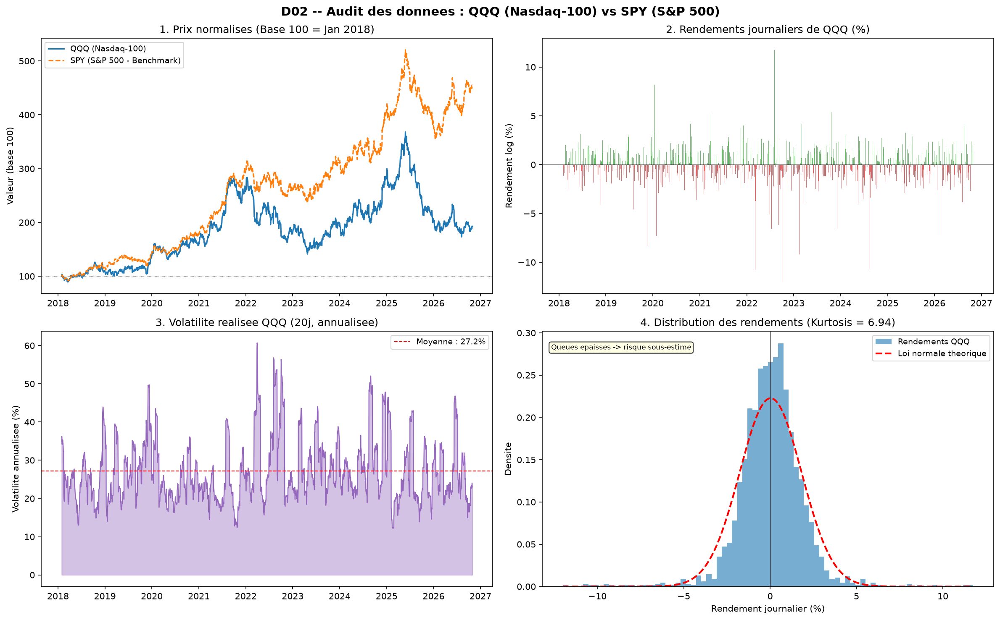

# QUANT LAB — Trading Intelligent (B01 · QQQ)

> **Projet :** Trading Intelligent — De la donnée de marché à une application de trading quantitatif  
> **Responsable pédagogique :** Pr. Tawfik Masrour | Département d'informatique — FS Rabat  
> **Actif étudié :** **QQQ** (Invesco QQQ Trust / Nasdaq-100) | **Benchmark :** **SPY** (S&P 500)  
> **Binôme :** Namrani Ilyas & Atattou Youssef  

---

### 📌 Documents de Référence & Navigation des Livrables

* 📄 **Document Fondateur :** [Consulter le Cahier des Charges Intégral du Projet](reports/cahier_des_charges.md)

| Livrable | Statut | Accès au document complet |
| :--- | :---: | :--- |
| **D01 — Cadrage & Architecture** | ✅ Validé | [Consulter le rapport D01](reports/D01_cadrage.md) |
| **D02 — Données, Ingestion & Audit** | 🚀 **Actuel (ci-dessous)** | *Affiché sur cette page* |
| **D03 — Économétrie de la moyenne** | ⏳ À venir | `reports/D03_econometrie.md` |
| **D04 — Module de Risque (GARCH)** | ⏳ À venir | `reports/D04_risque.md` |
| **D05 — Machine Learning & Deep Learning** | ⏳ À venir | `reports/D05_ml_dl.md` |
| **D06 — Stratégie & Backtesting** | ⏳ À venir | `reports/D06_backtest.md` |
| **D07 — Application Web (Streamlit)** | ⏳ À venir | Code `app.py` |
| **D08 — Paper Trading (5 séances)** | ⏳ À venir | `reports/D08_paper_trading.md` |
| **D09 — Reproductibilité & Tests** | ⏳ À venir | `tests/` & `pytest` |
| **D10 — Rapport Final & Soutenance** | ⏳ À venir | `reports/final_report.pdf` |

---

# Livrable Actuel : D02 — Données, Ingestion et Audit Qualité

## 1. Objectif du livrable D02

Le livrable D02 constitue la **fondation de toute la chaîne quantitative** du projet.
Son objectif est triple :

| Objectif | Description |
| :--- | :--- |
| **Collecter** | Télécharger les données historiques brutes de QQQ et SPY depuis Yahoo Finance et les sauvegarder localement. |
| **Auditer** | Contrôler rigoureusement la qualité et la cohérence des données avant tout traitement. |
| **Préparer** | Transformer les prix bruts en variables mathématiques exploitables par les modèles statistiques et de Machine Learning. |

---

## 2. Relation avec l'objectif global du projet

Le projet vise à répondre à la question scientifique suivante :

> *« Les modèles anticipant le risque améliorent-ils les décisions de trading sur un ETF technologique volatil (QQQ) ? »*

Pour y répondre, **tous les modules ultérieurs** (D03 : Économétrie, D04 : GARCH, D05 : Machine Learning, D06 : Backtest) ont besoin d'une même source de données **propre, cohérente et non biaisée**.

Le D02 remplit exactement ce rôle. Sans lui, les modèles apprendraient sur des données corrompues ou mal transformées, ce qui rendrait toutes les conclusions scientifiques invalides.

```
D02 (Ce livrable)
     │
     ├──► D03 : Modèles économétriques (ARIMA, SARIMAX)
     ├──► D04 : Modèle de risque (GARCH, VaR, ES)
     ├──► D05 : Machine Learning et Deep Learning
     └──► D06 : Moteur de backtesting et Paper Trading
```

---

## 3. Données utilisées

### 3.1 Actifs financiers

| Ticker | Nom complet | Rôle dans le projet |
| :--- | :--- | :--- |
| **QQQ** | Invesco QQQ Trust (Nasdaq-100) | Actif principal étudié |
| **SPY** | SPDR S&P 500 ETF Trust | Benchmark de comparaison + variable exogène (SARIMAX) |

### 3.2 Période d'étude

| Fenêtre | Période | Usage |
| :--- | :--- | :--- |
| Apprentissage | 2018 – 2022 | Entraînement des modèles |
| Validation | 2023 – 2024 | Réglage des hyperparamètres |
| Test final (gelé) | Jan 2025 – Oct 2026 | Évaluation hors-échantillon |

**Total : 2 304 séances boursières** (jours ouvrables uniquement).

### 3.3 Format OHLCV

Les données brutes sont au format standard OHLCV :

| Colonne | Signification | Remarque |
| :--- | :--- | :--- |
| `Open` | Prix d'ouverture | Premier prix de la séance |
| `High` | Plus haut de la journée | — |
| `Low` | Plus bas de la journée | — |
| `Close` | Prix de clôture **ajusté** | ⚠️ Voir note ci-dessous |
| `Volume` | Nombre d'actions échangées | Indicateur de liquidité |

> **Pourquoi le prix ajusté (Adj Close) et non le prix brut ?**
> Le prix de clôture brut est **biaisé** dans le temps par deux phénomènes :
> - **Les splits d'actions :** Si une action à 300 USD est divisée en 2 (split 2:1), le prix tombe à 150 USD. Ce n'est **pas une perte réelle**, mais le graphique brut montre une chute fictive de 50%.
> - **Les dividendes :** Quand une entreprise verse un dividende, le cours baisse mécaniquement du montant versé. Encore une distorsion artificielle.
>
> Le prix ajusté neutralise ces deux distorsions et garantit que les rendements calculés reflètent la **vraie performance économique** de l'investissement.

---

## 4. Étape 1 — Collecte et Snapshot Local

### Pourquoi ?
La reproductibilité est un critère fondamental de la démarche scientifique. Si les données changent entre deux exécutions (mises à jour de Yahoo Finance), les résultats ne sont plus comparables. De plus, le cahier des charges impose un **mode démonstration hors-ligne** pour la soutenance.

### Comment ?
- La bibliothèque Python `yfinance` interroge l'API Yahoo Finance.
- Dès le premier téléchargement, les données sont sauvegardées en CSV dans `data/raw/`.
- Lors des exécutions suivantes, le script **charge le snapshot local** sans toucher au réseau.

```python
# Logique de priorité : local d'abord, réseau si absent
if os.path.exists(snapshot_path) and not force_download:
    df = pd.read_csv(snapshot_path, ...)   # Mode hors-ligne
else:
    df = yf.download(ticker, ...)          # Téléchargement réseau
    df.to_csv(snapshot_path)               # Sauvegarde locale
```

### Fichiers produits
- `data/raw/QQQ_raw.csv`
- `data/raw/SPY_raw.csv`

---

## 5. Étape 2 — Audit Qualité

### Pourquoi ?
> *« Garbage in, garbage out. »*
>
> Un modèle statistique ou de Machine Learning **apprend des patterns dans les données**. S'il y a des erreurs dans les données (valeurs manquantes, doublons, incohérences), le modèle apprend de faux patterns et produit des décisions de trading incorrectes. L'audit est donc **non négociable**.

### Comment ? Les 5 vérifications effectuées

| Vérification | Ce qu'on cherche | Conséquence si ignoré |
| :--- | :--- | :--- |
| **1. Valeurs manquantes (NaN)** | Jours sans données | Erreurs de calcul dans ARIMA, GARCH |
| **2. Doublons d'index** | Même date deux fois | Données comptées deux fois → biais |
| **3. Cohérence OHLC** | Low ≤ Open, Close ≤ High | Signaux techniques erronés |
| **4. Volumes nuls** | Séances sans transaction | Jours fériés non filtrés |
| **5. Rendements extrêmes** | Mouvements > ±15% | Anomalies ou erreurs de données |

### Résultats de l'audit

#### QQQ
| Indicateur | Valeur | Statut |
| :--- | :--- | :--- |
| Période | 2018-01-02 → 2026-10-30 | ✅ |
| Nombre de séances | 2 304 | ✅ |
| Valeurs NaN | 0 | ✅ |
| Doublons | 0 | ✅ |
| Incohérences OHLC | 0 | ✅ |
| Volumes nuls | 0 | ✅ |
| Rendements > ±15% | 0 | ✅ |
| **Statut global** | **OK — PROPRES** | ✅ |

#### SPY
| Indicateur | Valeur | Statut |
| :--- | :--- | :--- |
| Période | 2018-01-02 → 2026-10-30 | ✅ |
| Nombre de séances | 2 304 | ✅ |
| Valeurs NaN | 0 | ✅ |
| Doublons | 0 | ✅ |
| Volumes nuls | 0 | ✅ |
| **Statut global** | **OK** | ✅ |

---

## 6. Étape 3 — Nettoyage

### Pourquoi ?
Même avec des données globalement propres, des micro-anomalies peuvent subsister (1 ou 2 NaN isolés sur une colonne secondaire). La stratégie de nettoyage doit être **conservative** : on ne supprime pas une ligne entière à cause d'un seul NaN, on l'impute intelligemment.

### Comment ?
Trois opérations dans l'ordre :

```
1. Tri chronologique       → garantit l'ordre temporel strict
2. Suppression des doublons → on garde la première occurrence
3. Forward-fill (max 1 jour) → un NaN isolé prend la valeur du jour précédent
                               (simule l'absence de transaction : prix inchangé)
```

> **Pourquoi forward-fill et pas suppression ?**  
> Supprimer une ligne crée un "trou" dans la série temporelle. Les modèles ARIMA et GARCH supposent des données régulièrement espacées dans le temps. Un trou fausserait les calculs d'autocorrélation et de volatilité.

---

## 7. Étape 4 — Ingénierie des Variables (Feature Engineering)

### Pourquoi cette étape est critique ?

Les modèles ne travaillent **jamais sur les prix bruts**. Voici pourquoi :

| Problème avec les prix bruts | Solution |
| :--- | :--- |
| Non stationnaires (ont une tendance) | Calculer les **rendements** (différences log) |
| Échelles incomparables (QQQ ≠ SPY en valeur absolue) | Les rendements sont comparables |
| Pas d'information sur la dynamique temporelle | Ajouter des variables **retardées** |
| Pas d'information sur le risque | Ajouter la **volatilité réalisée** |

### Principe fondamental : Zéro fuite d'information (*No Lookahead Bias*)

> ⚠️ **Règle absolue :** Toute variable calculée pour la date `t` ne doit utiliser que des informations **connues et disponibles à la clôture de `t`**. Il est **strictement interdit** d'utiliser des données de `t+1` ou plus pour prédire `t+1`.

Ce principe est garanti par l'utilisation systématique de `.shift()` pour les variables retardées.

### Les 7 variables construites

#### Variable cible (Y) — Ce qu'on veut prédire

```text
target_t = ln( P_QQQ[t+1] / P_QQQ[t] )
```

C'est le rendement logarithmique de QQQ à **demain** (`t+1`). C'est la seule variable du futur dans le dataset, et elle est **exclusivement réservée à l'évaluation** des modèles. Elle ne sera jamais utilisée comme variable d'entrée.

#### Variables d'entrée (X) — Ce qu'on connaît à `t`

| Variable | Formule de calcul | Interprétation |
| :--- | :--- | :--- |
| `r_qqq` | `ln( P_QQQ[t] / P_QQQ[t-1] )` | Rendement log de QQQ aujourd'hui |
| `r_spy` | `ln( P_SPY[t] / P_SPY[t-1] )` | Rendement log de SPY aujourd'hui |
| `r_qqq_lag1` | `r_qqq[t-1]` | Inertie court terme / momentum (hier) |
| `r_qqq_lag5` | `r_qqq[t-5]` | Effet hebdomadaire (il y a 5 séances) |
| `r_spy_lag1` | `r_spy[t-1]` | Variable exogène pour SARIMAX (B01) |
| `vol_20` | `std(r_qqq)` sur 20 séances | Thermomètre du risque historique récent |

> **Pourquoi le rendement logarithmique et pas le rendement simple ?**
> - Le rendement simple `(P[t] - P[t-1]) / P[t-1]` est asymétrique : une perte de 50% nécessite un gain de 100% pour revenir au point de départ.
> - Le rendement log `ln(P[t] / P[t-1])` est **additif dans le temps**, ce qui facilite les calculs cumulés et améliore les propriétés statistiques pour la modélisation.

> **Pourquoi vol_20 sur 20 séances ?**
> 20 séances = environ **1 mois de bourse** (4 semaines × 5 jours). C'est l'horizon standard en finance pour estimer la volatilité à court terme. Elle capte les changements de régime récents sans être trop sensible au bruit quotidien.

### Dataset final produit

```
Fichier : data/processed/features.csv
Dimensions : 2 283 séances × 9 variables

Statistiques descriptives :
                r_qqq      r_spy      vol_20      target
  count :       2 283      2 283       2 283       2 283
  mean  :      0.0003     0.0007      0.0172      0.0003
  std   :      0.0179     0.0120      0.0053      0.0179
  min   :     -0.1201    -0.0700      0.0077     -0.1201
  max   :      0.1176     0.0740      0.0382      0.1176
```

---

## 8. Étape 5 — Visualisations d'Audit

Quatre graphiques ont été générés pour permettre une inspection visuelle des données :

Les 4 graphiques sont générés automatiquement par `python src/data.py` et sauvegardés dans `reports/figures/`.



### Graphique 1 — Prix normalisés (Base 100 = Jan 2018)
**Pourquoi ?** Comparer QQQ et SPY sur la même échelle, indépendamment de leur prix de départ.

**Lecture :** Si la courbe QQQ est au-dessus de SPY, le Nasdaq-100 a sur-performé le marché large. C'est le **benchmark de référence** que votre stratégie algorithmique devra battre à terme.

### Graphique 2 — Rendements journaliers de QQQ
**Pourquoi ?** Visualiser les épisodes de crise (barres rouges profondes) et d'euphorie (barres vertes hautes).

**Lecture :** Les clusters de grandes barres révèlent les **régimes de volatilité** — exactement ce que le modèle GARCH (D04) tentera d'anticiper.

### Graphique 3 — Volatilité réalisée 20 jours (annualisée)
**Pourquoi ?** Montrer visuellement que la volatilité **n'est pas constante** dans le temps. C'est l'hypothèse fondamentale qui justifie l'utilisation du modèle GARCH.

**Lecture :** Les pics correspondent aux grandes crises (COVID-19 en 2020, hausse des taux en 2022...). Un modèle naïf qui suppose une volatilité constante sous-estimera dramatiquement le risque pendant ces périodes.

### Graphique 4 — Distribution des rendements vs Loi Normale
**Pourquoi ?** Tester si les rendements de QQQ suivent une loi normale (hypothèse de nombreux modèles classiques).

**Lecture :** Si la **kurtosis** (mesure de l'aplatissement) est élevée (> 3), les queues de distribution sont plus épaisses que la loi normale. Cela signifie que les **krachs extrêmes sont plus fréquents que ce que la théorie classique prédit** — d'où la nécessité de la VaR et de l'Expected Shortfall (D04).

---

## 9. Architecture du Code

```
src/data.py                    ← Script principal du D02
│
├── download_data()            ← Téléchargement + snapshot local
├── audit_quality()            ← 5 vérifications d'intégrité
├── clean_data()               ← Nettoyage conservateur
├── build_features()           ← Calcul des 7 variables
├── plot_all()                 ← 4 graphiques d'audit
└── run_pipeline()             ← Orchestration complète

src/generate_snapshots.py      ← Génération de données simulées (mode démo)
```

---

## 10. Reproductibilité

Pour reproduire exactement ce livrable depuis zéro :

```bash
# 1. Installer les dépendances
pip install -r requirements.txt

# 2. (Option A) Avec connexion Internet : données réelles Yahoo Finance
python src/data.py

# 2. (Option B) Sans connexion Internet : données simulées
python src/generate_snapshots.py
python src/data.py
```

**Sortie garantie :**
- `data/raw/QQQ_raw.csv` et `data/raw/SPY_raw.csv`
- `data/processed/features.csv`
- `reports/figures/D02_audit_donnees.png`

---

## 11. Conclusion et Transition vers D03

Le livrable D02 a produit un dataset propre, enrichi et prêt pour la modélisation :

- ✅ **2 304 séances** de données brutes collectées et auditées (QQQ + SPY).
- ✅ **0 anomalie critique** détectée sur QQQ.
- ✅ **9 variables** calculées, dont 7 variables d'entrée et 1 variable cible.
- ✅ **Mode hors-ligne** opérationnel pour la démonstration.
- ✅ **Principe No-Lookahead** strictement respecté.

Le dataset `features.csv` sera chargé directement par les modules suivants :
- **D03** utilisera `r_qqq`, `r_spy_lag1` pour les modèles ARIMA et SARIMAX.
- **D04** utilisera `r_qqq` pour détecter les effets ARCH et calibrer GARCH.
- **D05** utilisera toutes les variables d'entrée pour entraîner les modèles ML.
