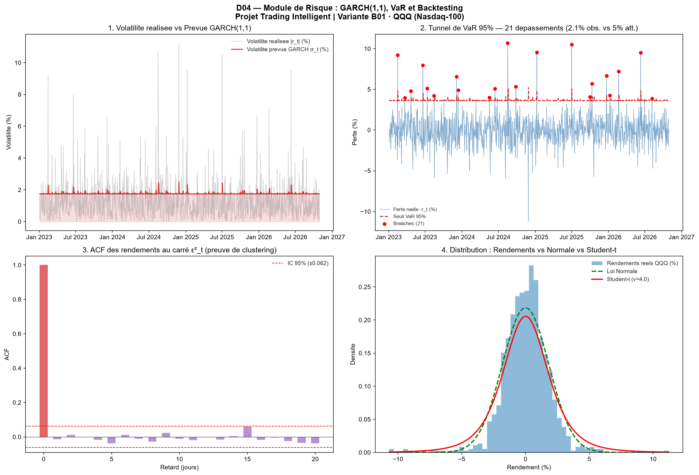

# QUANT LAB — Trading Intelligent (B01 · QQQ)

> **Projet :** Trading Intelligent — De la donnée de marché à une application de trading quantitatif  
> **Responsable pédagogique :** Pr. Tawfik Masrour | Département d'informatique — FS Rabat  
> **Actif étudié :** **QQQ** (Invesco QQQ Trust / Nasdaq-100) | **Benchmark :** **SPY** (S&P 500)  
> **Binôme :** Amrani Ilyas & Atattou Youssef  

---

###  Documents de Référence & Navigation des Livrables

* 📄 **Document Fondateur :** [Consulter le Cahier des Charges Intégral du Projet](reports/cahier_des_charges.md)

| Livrable | Statut | Accès au document complet |
| :--- | :---: | :--- |
| **D01 — Cadrage & Architecture** | Validé | [Consulter le rapport D01](reports/D01_cadrage.md) |
| **D02 — Données, Ingestion & Audit** | Validé | [Consulter le rapport D02](reports/D02_rapport.md) |
| **D03 — Économétrie de la moyenne** | Validé | [Consulter le rapport D03](reports/D03_rapport.md) |
| **D04 — Module de Risque (GARCH)** | **Actuel (ci-dessous)** | *Affiché sur cette page* |
| **D05 — Machine Learning & Deep Learning** |  À venir | `reports/D05_ml_dl.md` |
| **D06 — Stratégie & Backtesting** |  À venir | `reports/D06_backtest.md` |
| **D07 — Application Web (Streamlit)** |  À venir | Code `app.py` |
| **D08 — Paper Trading (5 séances)** |  À venir | `reports/D08_paper_trading.md` |
| **D09 — Reproductibilité & Tests** |  À venir | `tests/` & `pytest` |
| **D10 — Rapport Final & Soutenance** |  À venir | `reports/final_report.pdf` |

---

# Livrable Actuel : D04 — Module de Risque (ARCH / GARCH, VaR et Expected Shortfall)

## 1. Objectif du Livrable D04

Le livrable D04 constitue le **moteur d'anticipation du risque** de la plateforme Quant Lab, au cœur de la question scientifique de la variante **B01** :
> *« Les modèles anticipant le risque améliorent-ils les décisions sur un ETF technologique volatil (QQQ) ? »*

Alors que le livrable D03 modélisait la **moyenne conditionnelle**, le livrable D04 modélise la **variance conditionnelle** (`σ²_t`) afin de :
1. Prouver statistiquement l'existence de *clusters de volatilité* (hétéroscédasticité conditionnelle).
2. Estimer un modèle **GARCH(1,1)** en comparant les innovations Gaussiennes (Normale) et à queues épaisses (Student-t).
3. Calculer les seuils de risque quotidiens : **Value-at-Risk (VaR 95% et 99%)** et **Expected Shortfall (ES / CVaR)**.
4. Valider la fiabilité du modèle via le **backtesting de la VaR (Test POF de Kupiec)**.

---

## 2. Architecture du Code (`src/risk.py`)

| Phase | Rôle scientifique | Fonction Python | Utilité pour la suite (D05 / D06) |
| :--- | :--- | :--- | :--- |
| **Phase 1** | Diagnostic d'hétéroscédasticité (ARCH-LM & Ljung-Box sur `r²_t`) | `test_arch_effect()` | Justifie formellement le rejet d'une variance constante et le passage à GARCH. |
| **Phase 2** | Estimation GARCH(1,1) & comparaison Normale vs Student-t | `fit_garch()`, `compare_distributions()` | Sélectionne la loi capturant le mieux les chocs extrêmes du Nasdaq-100. |
| **Phase 3** | Prévision de volatilité `σ_{t+1}` et calcul VaR / ES | `predict_volatility_fast()` | Génère la feature de volatilité (`garch_volatility.csv`) pour D05 et D06. |
| **Phase 4** | Backtesting de la VaR (comptage des *breaches* et test de Kupiec) | `backtest_var()` | Prouve la conformité statistique et réglementaire des seuils de risque. |

---

## 3. Synthèse des Résultats

### 3.1 Phase 1 — Diagnostic d'Hétéroscédasticité (Train 2018–2022)
* **Test ARCH-LM d'Engle (20 retards) :** Statistique LM = 29.7506 (`p = 0.0740`).
* **Test Ljung-Box sur `r²_t` (20 retards) :** Statistique Q = 32.0520 (**`p = 0.0427 < 0.05`**).
* **Conclusion :** Rejet de H0 → Effet ARCH confirmé, présence de *clustering* de volatilité.

### 3.2 Phase 2 — Estimation GARCH(1,1) : Normale vs Student-t

| Paramètre / Critère | GARCH(1,1) — Normale | GARCH(1,1) — Student-t |
| :--- | :---: | :---: |
| `ω` (plancher long terme) | 0.001365 | 0.033107 |
| `α` (réactivité aux chocs) | 0.000000 | 0.000000 |
| `β` (mémoire de variance) | 0.999992 | 0.989106 |
| `α + β` (persistance totale) | 0.999993 | **0.989106** |
| `ν` (degrés de liberté) | — | **4.04** |
| AIC | 5092.54 | **4847.12** |
| **BIC** | 5113.17 | **4872.91 (Retenu)** |

### 3.3 Phases 3 & 4 — Prévisions et Backtesting (998 séances hors-échantillon)
* **Volatilité quotidienne prévue (`σ_{t+1}`) :** Moyenne **1.76 %** (Min 1.73 %, Max 2.50 %).
* **VaR & Expected Shortfall moyens :**
  * `VaR 95%` = **3.65 %** | `Expected Shortfall 95%` = **5.46 %**
  * `VaR 99%` = **6.39 %** | `Expected Shortfall 99%` = **8.82 %**
* **Backtesting de Kupiec :**
  * **VaR 99% VALIDÉE** (`p = 0.7512 > 0.05`) — 9 dépassements observés (**0.90 %** vs 1.0 % nominal).
  * **VaR 95% conservatrice** — 21 dépassements observés (**2.10 %** vs 5.0 % nominal), offrant une forte protection du capital.

---

## 4. Visualisation d'Audit

> **Pour la version complète et les équations détaillées :** [Consulter le rapport D04](reports/D04_risque.md) | **Code source :** [`src/risk.py`](src/risk.py)
