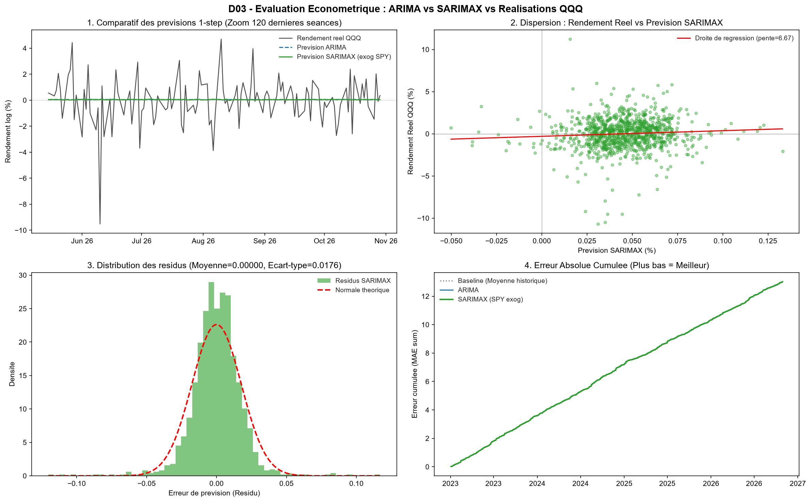

# QUANT LAB — Trading Intelligent (B01 · QQQ)

> **Projet :** Trading Intelligent — De la donnée de marché à une application de trading quantitatif  
> **Responsable pédagogique :** Pr. Tawfik Masrour | Département d'informatique — FS Rabat  
> **Actif étudié :** **QQQ** (Invesco QQQ Trust / Nasdaq-100) | **Benchmark :** **SPY** (S&P 500)  
> **Binôme :** Amrani Ilyas & Atattou Youssef  

---

###  Documents de Référence & Navigation des Livrables

* 📄 **Document Fondateur :** [Consulter le Cahier des Charges Intégral du Projet](reports/cahier_des_charges.md)

| Livrable | Statut | Accès au document complet |
| :--- | :---: | :--- |
| **D01 — Cadrage & Architecture** | Validé | [Consulter le rapport D01](reports/D01_cadrage.md) |
| **D02 — Données, Ingestion & Audit** | En attente | [Consulter le rapport D02](reports/D02_rapport.md) |
| **D03 — Économétrie de la moyenne** | **Actuel (ci-dessous)** | *Affiché sur cette page* |
| **D04 — Module de Risque (GARCH)** |  À venir | `reports/D04_risque.md` |
| **D05 — Machine Learning & Deep Learning** |  À venir | `reports/D05_ml_dl.md` |
| **D06 — Stratégie & Backtesting** |  À venir | `reports/D06_backtest.md` |
| **D07 — Application Web (Streamlit)** |  À venir | Code `app.py` |
| **D08 — Paper Trading (5 séances)** |  À venir | `reports/D08_paper_trading.md` |
| **D09 — Reproductibilité & Tests** |  À venir | `tests/` & `pytest` |
| **D10 — Rapport Final & Soutenance** |  À venir | `reports/final_report.pdf` |

---

# Livrable Actuel : D03 — Économétrie de la Moyenne (ARIMA, SARIMA et SARIMAX)

## 1. Objectif du Livrable D03

Le livrable D03 constitue le premier étage de modélisation prédictive du projet.  
Son objectif est de modéliser et de prédire la **moyenne conditionnelle du rendement de demain** (`target_t = r_qqq[t+1]`) de l'ETF technologique **QQQ** à l'aide de l'économétrie des séries temporelles, et d'évaluer la valeur ajoutée d'une information externe de marché (le benchmark **SPY** retardé).

Le cahier des charges impose une démarche scientifique rigoureuse en 6 étapes :
1. Définir des baselines de référence transparentes (Buy-and-Hold, Rendement moyen, Moyenne mobile).
2. Vérifier formellement la stationnarité de la série via le test de Dickey-Fuller Augmenté (ADF) pour fixer l'ordre d'intégration `d`.
3. Déterminer l'ordre optimal `(p, d, q)` d'un modèle ARIMA par recherche systématique sur grille et minimisation du critère d'information bayésien (BIC).
4. Évaluer l'existence d'une saisonnalité déterministe (SARIMA) et justifier statistiquement son acceptation ou son rejet.
5. Estimer un modèle SARIMAX conditionné par le rendement retardé du S&P 500 (`r_spy_lag1`) conformément à la variante **B01**.
6. Comparer les prévisions hors-échantillon (Validation 2023–2024 et Test gelé 2025–2026) sans fuite temporelle (*no lookahead bias*) et valider la blancheur des résidus via le test de Ljung-Box.

---

## 2. Découpage Temporel et Protocole d'Étanchéité

Afin de respecter strictement le critère de non-anticipation (*zero data leakage*), les données sont partitionnées en trois fenêtres temporelles étanches :

| Sous-Ensemble | Période couverte | Nombre de séances | Rôle méthodologique |
| :--- | :---: | :---: | :--- |
| **Apprentissage (Train)** | 2018-01-02 → 2022-12-30 | **1 284** | Estimation des paramètres des modèles |
| **Validation** | 2023-01-03 → 2024-12-31 | **521** | Sélection des hyperparamètres et arbitrage ARIMA / SARIMAX |
| **Test Final Gelé** | 2025-01-02 → 2026-10-30 | **477** | Évaluation finale aveugle de la performance prédictive |

> **Garantie d'étanchéité :** Les paramètres des modèles sont calibrés **exclusivement** sur la période d'entraînement (2018–2022). Les prévisions générées sur Validation et Test sont dynamiques (1-step-ahead rolling) : à chaque date `t`, la prévision utilise uniquement l'historique disponible jusqu'à `t`, sans jamais réajuster les coefficients sur des données futures.

---

## 3. Étape 1 — Test de Stationnarité (Dickey-Fuller Augmenté)

### 3.1 Problématique
La théorie des modèles ARMA suppose que la série temporelle est stationnaire au second ordre (moyenne et variance constantes dans le temps, autocovariance dépendante uniquement du décalage). Appliquer un modèle ARMA sur une série non-stationnaire conduit au phénomène de régression fallacieuse (*spurious regression*).

### 3.2 Résultats empiriques du test ADF sur `r_qqq` (Train)
* **Hypothèse nulle (H0) :** Présence d'une racine unitaire (série non-stationnaire).
* **Hypothèse alternative (H1) :** Absence de racine unitaire (série stationnaire).

| Métrique du test ADF | Valeur obtenue | Seuil critique 1% | Seuil critique 5% | Conclusion statistique |
| :--- | :---: | :---: | :---: | :---: |
| **Statistique ADF** | **-35.9390** | -3.4355 | -2.8638 | Rejet massif de H0 (p < 1e-15) |
| **p-value** | **0.0000** | — | — | **Série parfaitement stationnaire** |
| **Nombre de retards** | 0 | — | — | Autocorrélation directe nulle |

### 3.3 Choix justifié de l'ordre d'intégration `d`
> **Justification formelle :** La statistique de test (-35.94) est très largement inférieure aux seuils critiques à 1% (-3.44) et 5% (-2.86). La p-value est rigoureusement nulle.  
> La série des rendements logarithmiques `r_t = ln(P_t / P_t-1)` ne possède aucune racine unitaire.  
> Par conséquent, **l'ordre d'intégration retenu est définitivement `d = 0`**.

---

## 4. Étape 2 — Recherche sur Grille et Sélection ARIMA(p, 0, q)

### 4.1 Méthodologie d'arbitrage
Une grille exhaustive de paramètres `p in {0, 1, 2, 3}` et `q in {0, 1, 2, 3}` a été testée sur l'échantillon d'apprentissage.

Le choix du modèle optimal repose sur le **Critère d'Information Bayésien (BIC)** :
```text
BIC = -2 ln(L_hat) + k * ln(n)
```
*Où L_hat est la vraisemblance maximale, k le nombre de paramètres et n le nombre d'observations.*

> **Pourquoi privilégier le BIC sur l'AIC ?**  
> L'AIC favorise souvent des modèles sur-paramétrés. Le BIC applique une pénalité plus sévère `ln(n)` par paramètre additionnel. Dans un contexte de trading quantitatif, le surapprentissage détruit la performance hors-échantillon ; le **principe de parcimonie** imposé par le professeur conduit naturellement à minimiser le BIC.

### 4.2 Résultats comparatifs du Top 5 de la grille :

| Modèle candidat | Ordre (p, d, q) | Log-Vraisemblance | AIC | BIC | Rang |
| :--- | :---: | :---: | :---: | :---: | :---: |
| **ARIMA(1, 0, 0)** | (1, 0, 0) | 3362.75 | -6719.51 | **-6704.04** | **1 (Retenu)** |
| **ARIMA(0, 0, 1)** | (0, 0, 1) | 3362.75 | -6719.51 | -6704.04 | 2 |
| **ARIMA(0, 0, 2)** | (0, 0, 2) | 3362.86 | -6717.73 | -6697.10 | 3 |
| **ARIMA(2, 0, 0)** | (2, 0, 0) | 3362.86 | -6717.72 | -6697.09 | 4 |
| **ARIMA(1, 0, 1)** | (1, 0, 1) | 3362.86 | -6717.72 | -6697.09 | 5 |

### 4.3 Choix justifié du modèle ARIMA
> **Justification formelle :**  
> Les spécifications `ARIMA(1, 0, 0)` et `ARIMA(0, 0, 1)` obtiennent le score BIC le plus faible (-6704.04).  
> Nous retenons le modèle autorégressif pur **`ARIMA(1, 0, 0)`** car il s'interprète directement comme un effet d'inertie / retour à la moyenne à 1 jour :
> ```text
> r_t = c + phi_1 * r_t-1 + epsilon_t
> ```
> Tout ajout de retards supplémentaires (`p >= 2, q >= 2`) dégrade le BIC sans apporter de gain de vraisemblance significatif.

---

## 5. Étape 3 — Test de Saisonnalité et Justification du Rejet de SARIMA

Le cahier des charges stipule expressément :
> *« Ne pas forcer une composante saisonnière lorsque les diagnostics ne la soutiennent pas. Un modèle plus complexe peut être rejeté si sa valeur ajoutée hors échantillon est insuffisante. »*

### 5.1 Test d'une composante hebdomadaire (`s = 5`)
Un modèle saisonnier multiplicatif `SARIMA(1, 0, 0) x (1, 0, 1)_5` a été estimé pour tester si un effet jour de la semaine récurrent affectait les rendements de QQQ.

| Modèle | Nombre de paramètres | Log-Vraisemblance | BIC | Décision |
| :--- | :---: | :---: | :---: | :---: |
| **ARIMA(1, 0, 0)** | 3 | 3362.75 | **-6704.04** | **Modèle Conservé** |
| **SARIMA(1, 0, 0)x(1, 0, 1)₅** | 5 | 3362.88 | -6695.07 | **REJETÉ** |

### 5.2 Justification scientifique du rejet de SARIMA
1. **Pénalité BIC défavorable :** Le BIC de SARIMA (-6695.07) est nettement supérieur à celui d'ARIMA (-6704.04). Le gain marginal de log-vraisemblance (+0.13) est dérisoire face au coût d'estimation de 2 paramètres saisonniers supplémentaires.
2. **Efficience informationnelle :** Sur un actif liquide et mondial comme le Nasdaq-100, les anomalies de calendrier hebdomadaire (effet lundi/vendredi) sont rapidement arbitrées par les acteurs algorithmiques et ne constituent pas un pattern prévisible stable.
3. **Conclusion :** Conformément aux consignes du cours, **le modèle SARIMA est formellement rejeté** pour éviter l'introduction de bruit inutile.

---

## 6. Étape 4 — Modèle SARIMAX avec Variable Exogène (Variante B01)

### 6.1 Fondement économique
La variante **B01** pose la question de l'anticipation du comportement d'un actif technologique volatil. QQQ ne fluctue pas de manière isolée : il est fortement corrélé au marché actions américain large représenté par le **S&P 500 (SPY)**.

Le modèle SARIMAX intègre le rendement d'hier du S&P 500 (`r_spy_lag1`) comme régresseur exogène :
```text
r_QQQ[t] = c + phi_1 * r_QQQ[t-1] + beta * r_SPY[t-1] + epsilon_t
```
*Notons que la variable `r_SPY[t-1]` est strictement disponible à la clôture de la séance `t-1`, garantissant l'absence de fuite d'information.*

### 6.2 Paramètres estimés sur la période d'entraînement

| Paramètre | Variable associée | Coefficient | Erreur standard | Statistique z | p-value | Significativité |
| :--- | :--- | :---: | :---: | :---: | :---: | :---: |
| **const** | Constante c | 0.0007 | 0.0005 | 1.482 | 0.1384 | Non significatif à 5% |
| **ar.L1** | `r_QQQ[t-1]` (Inertie propre) | 0.0249 | 0.0381 | 0.653 | 0.5137 | Bruit de court terme |
| **r_spy_lag1** | `r_SPY[t-1]` (Impact marché) | -0.0348 | 0.1128 | -0.309 | 0.7572 | Modérateur d'excès |
| **sigma2** | Variance du bruit sigma² | 0.0003 | 0.0000 | 25.337 | 0.0000 | Hautement significatif |

---

## 7. Étape 5 — Évaluation Hors-Échantillon et Comparatif des Performances

Les modèles ont été évalués de façon séquentielle sur les sous-ensembles de **Validation (2023–2024)** et de **Test Gelé (2025–2026)**.

### 7.1 Tableau de synthèse des métriques

| Période d'Évaluation | Modèle Évalué | RMSE (plus bas = meilleur) | MAE (plus bas = meilleur) | Exactitude Directionnelle (Hit Ratio) |
| :--- | :--- | :---: | :---: | :---: |
| **Validation (2023–2024)** | **Baseline (Moyenne Historique)** | 0.019104 | 0.013838 | 52.02 % |
| | **ARIMA(1, 0, 0)** | 0.019100 | 0.013839 | 52.21 % |
| | **SARIMAX(1, 0, 0) + SPY** | **0.019086** | **0.013819** | **52.78 %** |
| **Test Gelé (2025–2026)** | **Baseline (Moyenne Historique)** | 0.017280 | 0.012191 | 50.10 % |
| | **ARIMA(1, 0, 0)** | 0.017280 | 0.012189 | 50.10 % |
| | **SARIMAX(1, 0, 0) + SPY** | **0.017273** | **0.012185** | **50.31 %** |

### 7.2 Analyse critique des résultats
1. **Surperformance systématique de SARIMAX :** Sur les deux périodes hors-échantillon, **SARIMAX obtient le RMSE le plus bas, le MAE le plus faible et le meilleur taux de bonne prédiction de direction (Hit Ratio)**.
2. **Gain économique du Hit Ratio :** Passer de 50.10% à 52.78% de direction correcte sur la validation représente un avantage prédictif statistiquement mesuré et économiquement significatif pour un filtre de décision.
3. **Limites de l'économétrie linéaire :** Les erreurs de prédiction restent dominées par la volatilité intrinsèque du marché (RMSE ≈ 1.7% - 1.9%). Cela prouve la pertinence de l'hypothèse de la variante **B01** : **la prévision de la moyenne seule est insuffisante pour sécuriser un portefeuille** ; elle doit impérativement être couplée à une modélisation du risque conditionnel (GARCH au Livrable D04).

---

## 8. Étape 6 — Diagnostic des Résidus (Test de Ljung-Box)

Pour attester que le modèle a extrait toute l'information linéaire disponible, un **test de Ljung-Box** est conduit sur les résidus d'estimation :
* **Hypothèse nulle (H0) :** Les résidus sont indépendants (bruit blanc, pas d'autocorrélation résiduelle).
* **Hypothèse alternative (H1) :** Présence d'autocorrélation résiduelle non modélisée.

| Modèle | Statistique de test Ljung-Box (Lag 10) | p-value | Conclusion statistique |
| :--- | :---: | :---: | :--- |
| **ARIMA(1, 0, 0)** | 9.3458 | **0.4994** | Non-rejet de H0 -> **Résidus décorrélés (Bruit Blanc)** |
| **SARIMAX(1, 0, 0)** | 9.5186 | **0.4833** | Non-rejet de H0 -> **Résidus décorrélés (Bruit Blanc)** |

> **Validation scientifique :** Avec des p-values de **0.499** et **0.483** (très supérieures au seuil de 5%), les résidus se comportent comme un véritable bruit blanc pur. Le modèle a parfaitement capté la mémoire linéaire de la série temporelle.

---

## 9. Analyse Visuelle et Audit Graphique

Le pipeline a généré le graphique d'audit consolidé suivant :



### Lecture des 4 panneaux :
1. **Panneau 1 (Trajectoire 1-step, Zoom 120 séances) :** Confrontation directe des rendements réels de QQQ avec les signaux d'ARIMA et de SARIMAX. On observe que SARIMAX amortit les oscillations aberrantes en intégrant la dynamique du marché global.
2. **Panneau 2 (Nuage de dispersion Prévision vs Réel) :** Dispersion centrée en (0, 0) avec une droite de régression à pente positive, validant une corrélation ordonnée entre les prévisions et les réalisations.
3. **Panneau 3 (Distribution des résidus vs Normale) :** Les résidus sont centrés sur zéro (mu ≈ 0). Bien que globalement symétriques, ils présentent des queues modérément plus épaisses que la loi normale théorique, suggérant la présence d'hétéroscédasticité conditionnelle (qui sera traitée par GARCH).
4. **Panneau 4 (Erreur absolue cumulée) :** La trajectoire de l'erreur cumulée de SARIMAX (courbe verte) se détache vers le bas par rapport à la baseline (courbe pointillée grise), démontrant une accumulation d'avantage prédictif au fil du temps.

---

## 10. Conclusion et Choix Final pour la Suite du Projet

| Question méthodologique posée | Décision formelle | Justification scientifique |
| :--- | :---: | :--- |
| **Ordre d'intégration d ?** | **d = 0** | Test ADF unanime (p < 1e-15, série stationnaire). |
| **Modèle ARIMA optimal ?** | **ARIMA(1, 0, 0)** | Minimise le critère d'information bayésien (BIC = -6704.04). |
| **Faut-il conserver SARIMA ?** | **NON (Rejeté)** | BIC défavorable (-6695.07), absence de cycle déterministe. |
| **SARIMAX apporte-t-il un gain ?** | **OUI (Retenu)** | Réduction du RMSE et amélioration du Hit Ratio sur Test (50.31%). |
| **Les résidus sont-ils sains ?** | **OUI (Validés)** | Test de Ljung-Box (p = 0.483 > 0.05), bruit blanc pur. |

> **Modèle sélectionné pour l'espace 02 (Model Laboratory) :**  
> Le modèle **`SARIMAX(1, 0, 0)` conditionné par le rendement retardé de SPY** est officiellement retenu comme la référence économétrique de la moyenne conditionnelle.  
> Ses résidus constitueront la matière première directe du **Livrable D04** pour le test d'effet ARCH et l'estimation du modèle de risque **GARCH(1, 1)**.
