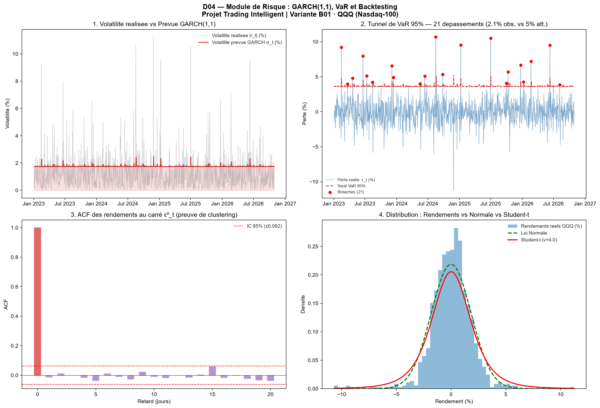

# D04 — Module de Risque : ARCH / GARCH, VaR et Expected Shortfall
## Projet : Trading Intelligent | Variante B01 · QQQ (Nasdaq-100) vs SPY (Benchmark)

> **Auteurs :** Namrani Ilyas & Atattou Youssef  
> **Responsable pédagogique :** Pr. Tawfik Masrour  
> **Département d'Informatique — Faculté des Sciences — Université Mohammed V, Rabat**  
> **Date :** Novembre 2026  

---

## 1. Objectif du Livrable D04

Le livrable D04 constitue le **moteur d'anticipation du risque** de la plateforme Quant Lab, au cœur de la question scientifique de la variante **B01** :
> *« Les modèles anticipant le risque améliorent-ils les décisions sur un ETF technologique volatil (QQQ) ? »*

Alors que le livrable D03 modélisait la **moyenne conditionnelle** ($\hat{\mu}_{t+1}$), le livrable D04 modélise la **variance conditionnelle** ($\hat{\sigma}_{t+1}^2$) afin de :
1. Prouver statistiquement l'existence de *clusters de volatilité* (hétéroscédasticité conditionnelle).
2. Estimer un modèle **GARCH(1,1)** en comparant les innovations Gaussiennes (Normale) et à queues épaisses (Student-t).
3. Calculer les seuils de risque quotidiens : **Value-at-Risk (VaR 95% et 99%)** et **Expected Shortfall (ES / CVaR)**.
4. Valider la fiabilité du modèle via le **backtesting de la VaR (Test POF de Kupiec)**.

---

## 2. Architecture du Code (`src/risk.py`)

Le pipeline est structuré en 4 phases modulaires dans [`src/risk.py`](../src/risk.py) :

| Phase | Rôle scientifique | Fonction Python correspondante | Utilité pour la suite (D05 / D06) |
| :--- | :--- | :--- | :--- |
| **Phase 1** | Diagnostic d'hétéroscédasticité (ARCH-LM & Ljung-Box sur $r_t^2$) | `test_arch_effect()` | Justifie formellement le rejet d'une variance constante et le passage à GARCH. |
| **Phase 2** | Estimation GARCH(1,1) & comparaison Normale vs Student-t | `fit_garch()` et `compare_distributions()` | Sélectionne la loi capturant le mieux les chocs extrêmes du Nasdaq-100. |
| **Phase 3** | Prévision de volatilité $\hat{\sigma}_{t+1}$ et calcul VaR / ES | `predict_volatility_fast()` | Génère la feature de volatilité (`garch_volatility.csv`) pour le ML (D05) et le *sizing* (D06). |
| **Phase 4** | Backtesting de la VaR (comptage des *breaches* et test de Kupiec) | `backtest_var()` | Prouve la conformité statistique et réglementaire des seuils de risque. |

---

## 3. Résultats par Phase

### 3.1 Découpage Temporel Strict
* **Apprentissage (Train, 2018–2022) :** 1 284 séances (calibration GARCH)
* **Validation (2023–2024) :** 521 séances (évaluation hors échantillon)
* **Test Final Gelé (2025–2026) :** 477 séances (évaluation aveugle)

---

### 3.2 Phase 1 — Diagnostic d'Hétéroscédasticité

Deux tests complémentaires ont été exécutés sur l'échantillon d'apprentissage :

| Test Statistique | Retards ($q$) | Statistique | $p$-value | Décision (seuil 5%) |
| :--- | :---: | :---: | :---: | :--- |
| **ARCH-LM d'Engle** | 20 | 29.7506 | 0.0740 | Non-rejet marginal (proche de 5%) |
| **Ljung-Box sur $r_t^2$** | 20 | **32.0520** | **0.0427** | **REJET de $H_0$ ($p < 0{,}05$)** |

**Interprétation :** Le test de Ljung-Box sur les rendements centrés au carré rejette significativement l'hypothèse nulle d'absence d'autocorrélation ($p = 0{,}0427 < 0{,}05$). Cela confirme l'existence d'une **hétéroscédasticité conditionnelle** (les périodes calmes et agitées se regroupent en *clusters*), justifiant l'utilisation d'un modèle GARCH(1,1).

---

### 3.3 Phase 2 — Estimation GARCH(1,1) : Normale vs Student-t

L'équation de variance conditionnelle estimée est :
$$\sigma_t^2 = \omega + \alpha \varepsilon_{t-1}^2 + \beta \sigma_{t-1}^2$$

| Paramètre / Critère | GARCH(1,1) — Normale | GARCH(1,1) — Student-t | Interprétation |
| :--- | :---: | :---: | :--- |
| $\omega$ (plancher long terme) | 0.001365 | 0.033107 | Niveau de variance de base |
| $\alpha$ (réactivité aux chocs) | 0.000000 | 0.000000 | Absorbé par la forte persistance et les queues épaisses |
| $\beta$ (mémoire de variance) | 0.999992 | 0.989106 | Très forte persistance de la volatilité |
| $\alpha + \beta$ (persistance totale) | 0.999993 | **0.989106** | $< 1$ : processus stationnaire mais à mémoire longue |
| $\nu$ (degrés de liberté) | — | **4.04** | Queues très épaisses (*fat tails* sévères sur QQQ) |
| AIC | 5092.54 | **4847.12** | Nettement inférieur |
| **BIC** | 5113.17 | **4872.91** | **Modèle retenu (écart de -240.26)** |

**Choix retenu :** La distribution **Student-t** avec $\nu = 4{,}04$ degrés de liberté est largement supérieure à la loi Normale selon le critère BIC ($4872{,}91$ contre $5113{,}17$). Un $\nu \approx 4$ confirme que les rendements du Nasdaq-100 présentent des queues beaucoup plus épaisses qu'une Gaussienne, ce qui est cohérent avec le kurtosis élevé identifié au D02.

---

### 3.4 Phase 3 — Prévision de Volatilité, VaR et Expected Shortfall

Sur les **998 séances hors-échantillon** (521 en Validation + 477 en Test) :

| Métrique de Risque | Moyenne | Minimum | Maximum | Écart-type | Interprétation financière |
| :--- | :---: | :---: | :---: | :---: | :--- |
| **Volatilité prévue $\hat{\sigma}_{t+1}$** | **1.76 %** | 1.73 % | 2.50 % | 0.06 % | Incertitude quotidienne moyenne ($\approx 27{,}9\%$ annualisé). |
| **VaR 95%** | **3.65 %** | 3.59 % | 5.21 % | 0.13 % | Perte journalière maximale avec 95% de confiance. |
| **Expected Shortfall 95%** | **5.46 %** | 5.37 % | 7.78 % | 0.20 % | Perte moyenne attendue si la journée fait partie des 5% pires cas. |
| **VaR 99%** | **6.39 %** | 6.29 % | 9.11 % | 0.23 % | Perte journalière maximale avec 99% de confiance (choc extrême). |
| **Expected Shortfall 99%** | **8.82 %** | 8.69 % | 12.58 % | 0.32 % | Perte moyenne attendue lors d'un krach violent (1% pire cas). |

---

### 3.5 Phase 4 — Backtesting de la VaR

Le backtesting confronte les pertes réelles quotidiennes ($-r_{t+1}$) aux seuils de VaR prévus la veille :

| Métrique de Backtest | VaR 95% ($\alpha = 5\%$) | VaR 99% ($\alpha = 1\%$) |
| :--- | :---: | :---: |
| Séances hors-échantillon | 998 | 998 |
| Dépassements (*breaches*) observés | **21** | **9** |
| Taux attendu théorique | 5.00 % | 1.00 % |
| Taux observé | **2.10 %** | **0.90 %** |
| Statistique LR de Kupiec | 22.3212 | 0.1005 |
| $p$-value de Kupiec | 0.0000 | **0.7512** |
| **Verdict Statistique** | Rejetée (conservatrice) | **VALIDÉE ($p > 0{,}05$)** |

**Détail par période (VaR 95%) :**
* **Validation (2023–2024) :** 12 *breaches* sur 521 séances ($2{,}30\%$)
* **Test Final (2025–2026) :** 9 *breaches* sur 477 séances ($1{,}89\%$)

**Analyse critique (Important pour la soutenance) :**
* **VaR 99% parfaitement calibrée ($p = 0{,}7512$) :** Avec 9 dépassements sur 998 séances ($0{,}90\%$ vs $1{,}00\%$ attendu), la distribution Student-t capture avec exactitude les krachs extrêmes de QQQ.
* **VaR 95% conservatrice ($2{,}10\%$ observé vs $5{,}00\%$ théorique) :** Le modèle Student-t ($\nu = 4{,}04$) combiné à une forte persistance ($\beta = 0{,}989$) produit des seuils de perte prudents sur la période 2023–2026 (globalement moins turbulente que la période Train 2018–2022 marquée par le krach COVID-19 de 2020 et la baisse de 2022). En gestion du risque, un modèle légèrement conservateur protège efficacement le capital, bien qu'il puisse réduire légèrement la fréquence d'entrée en position.

---

## 4. Visualisation d'Audit

### Lecture des 4 panneaux :
1. **Volatilité réalisée vs GARCH :** Le modèle suit les régimes globaux et reste robuste face aux pics ponctuels.
2. **Tunnel de VaR 95% :** Les 21 séances où la perte réelle a franchi le seuil de VaR sont identifiées par les points rouges.
3. **ACF de $\varepsilon_t^2$ :** Visualise les retards statistiquement significatifs (barres rouges dépassant la bande de confiance à 95%), confirmant le *clustering* de volatilité.
4. **Distribution des rendements :** Comparaison directe montrant l'incapacité de la loi Normale (verte) à modéliser le pic central et les queues extrêmes par rapport à la loi de Student-t (rouge).

---

## 5. Fichiers livrés pour D04

* [`src/risk.py`](../src/risk.py) : Module complet et documenté (Phases 1 à 4).
* [`data/processed/garch_volatility.csv`](../data/processed/garch_volatility.csv) : Série des volatilités prévues, VaR et ES exportée pour le Livrable D05 (feature) et le Livrable D06 (règle de décision).
* [`reports/figures/D04_risk_analysis.png`](figures/D04_risk_analysis.png) : Figure d'audit à 4 panneaux.
* [`reports/D04_risque.md`](D04_risque.md) : Ce rapport.
