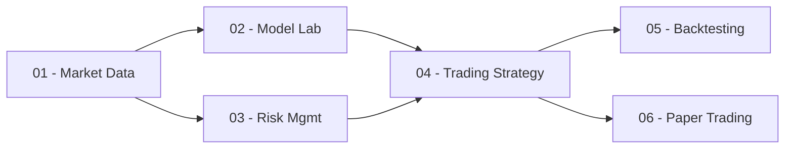

# CAHIER DES CHARGES DÉTAILLÉ
## QUANT LAB — DE LA DONNÉE DE MARCHÉ À UNE APPLICATION DE TRADING QUANTITATIF
### Variante B01 · QQQ (Invesco QQQ Trust / Nasdaq-100) vs SPY (Benchmark S&P 500)

---

> **Projet de cours :** Trading Intelligent / Projet Intégrateur  
> **Auteur et Responsable Pédagogique :** Pr. Tawfik Masrour  
> **Département d'Informatique — Faculté des Sciences — Université Mohammed V, Rabat**  
> **Cadre académique :** Année Universitaire 2026 / 2027  
> **Équipe projet (Binôme B01) :** Amrani Ilyas & Atattou Youssef  

---

## 1. Contexte et Philosophie du Projet

### 1.1 Contexte Général
Le projet **Quant Lab** place le binôme d'étudiants dans la posture d'une équipe de recherche et d'ingénierie quantitative (*Quantitative Research & Development*) au sein d'une institution financière moderne. 

Le but n'est pas de concevoir un système isolé de notebooks exploratoires, mais de livrer un **logiciel complet, modulaire, reproductible et défendable scientifiquement**, matérialisé par une **application Web interactive sous Streamlit**.

### 1.2 La Philosophie de l'Évaluation
* **Rigueur scientifique avant le profit :** La première qualité d'une stratégie de trading quantitative n'est pas d'afficher un gain virtuel mirobolant, mais de reposer sur un protocole honnête, vérifiable et mathématiquement sain.
* **Absence totale de fuite d'information (*No Lookahead Bias*) :** Aucune décision de trading ne peut utiliser une information qui n'était pas connue et consolidée à l'instant où l'ordre est généré.
* **Maîtrise du risque :** L'accent est mis sur la préservation du capital, le dimensionnement des positions (*position sizing*), la volatilité conditionnelle et la gestion des crises.

---

## 2. Périmètre de la Variante B01

### 2.1 Les Actifs Étudiés
* **Actif Cible : `QQQ` (Invesco QQQ Trust)**
  * ETF répliquant l'indice Nasdaq-100 (les 100 plus grandes capitalisations non financières américaines).
  * Caractéristiques : forte exposition aux valeurs technologiques (Apple, Microsoft, Nvidia, Amazon, Alphabet, Meta), forte croissance séculaire, mais susceptibilité à des drawdowns brutaux et une volatilité élevée.
* **Benchmark Commun : `SPY` (SPDR S&P 500 ETF Trust)**
  * ETF répliquant l'indice S&P 500 (les 500 plus grandes entreprises américaines diversifiées).
  * Sert d'étalon passif de référence (*Buy & Hold*) et de variable exogène de marché.

### 2.2 Problématique Scientifique Spécifique (B01)
* **Question de recherche centrale :**
  > *« Les modèles anticipant le risque améliorent-ils les décisions de trading sur un ETF technologique volatil (QQQ) ? »*
* **Expérience distinctive obligatoire :**
  Comparer rigoureusement la performance, la stabilité et le comportement des stratégies selon deux régimes :
  1. Régime de **faible volatilité récente** (marché calme / tendance haussière).
  2. Régime de **forte volatilité récente** (marché agité / épisodes de stress).
* **Angle de discussion final :**
  Démontrer l'efficacité du contrôle dynamique de l'exposition (piloté par la volatilité GARCH et des seuils de Value-at-Risk) par rapport à un investissement à taille fixe ou passif.

---

## 3. Cadre Opérationnel et Règles de Simulation

Toutes les simulations de trading doivent strictement respecter les règles de gestion suivantes :

| Paramètre | Spécification Impérative |
| :--- | :--- |
| **Capital initial** | **100 000 USD** virtuels (fictifs, aucun argent réel). |
| **Univers d'investissement** | **Long / Cash uniquement** (fraction investie entre 0% et 100%). |
| **Restrictions de position** | **Aucune vente à découvert (Short interdite)**, **aucun effet de levier**, **aucun emprunt**. |
| **Fréquence des décisions** | Données journalières. Décision prise après la clôture $t$, exécution à l'ouverture $t+1$. |
| **Frais de courtage** | $0{,}05\%$ par transaction (achat ou vente). |
| **Glissement (*Slippage*)** | $0{,}05\%$ par transaction (hypothèse de friction de liquidité). |
| **Coût total standard** | **$0{,}10\%$ par transaction** ($0{,}20\%$ aller-retour). |
| **Stress-test de sensibilité** | Scénario obligatoire à **coûts doublés : $0{,}20\%$ par transaction** ($0{,}40\%$ aller-retour). |

---

## 4. Découpage Temporel et Traçabilité des Données

Afin de garantir l'absence totale de surapprentissage (*overfitting*) et de fuite temporelle, l'historique est découpé en trois fenêtres temporelles étanches :

```
├───────────────────────┼───────────────────┼────────────────────────┤
│   APPRENTISSAGE       │    VALIDATION     │       TEST GELÉ        │
│    (2018 – 2022)      │   (2023 – 2024)   │  (01/01/2025 - 10/2026) │
│  Entraînement initial │  Hyperparamètres  │    Évaluation finale   │
└───────────────────────┴───────────────────┴────────────────────────┘
```

* **Principe d'étanchéité :** Les paramètres de normalisation (moyenne, écart-type) et les hyperparamètres de modèles sont appris sur la période d'entraînement/validation et appliqués tels quels sur le jeu de test sans jamais réajuster sur le futur.
* **Souveraineté locale (Mode démo) :** L'application doit obligatoirement fonctionner en mode démo déconnecté à partir d'un snapshot local figé (`data/raw/` et `data/processed/`), garantissant la démonstration même en cas de coupure de réseau.

---

## 5. Spécifications Fonctionnelles de l'Application Web (Streamlit)

L'application Web doit être fluide, intuitive pour un non-initié, et structurée en **6 espaces fonctionnels obligatoires** :



### Espace 01 — Market Data (Données de Marché)
* Sélection interactive de l'actif (QQQ) et du benchmark (SPY).
* Graphiques interactifs (cours ajustés, volumes, rendements logarithmiques).
* Tableau de bord d'audit qualité des données (détection des anomalies, valeurs manquantes, statistiques descriptives).
* Mode d'actualisation en ligne et mode snapshot local (hors-ligne).

### Espace 02 — Model Laboratory (Laboratoire de Modélisation)
* Entraînement et comparaison des prévisions de rendement ($\hat{r}_{t+1}$) :
  * **Baselines :** Buy-and-Hold, Rendement moyen historique, Moyenne mobile.
  * **Économétrie :** ARIMA, SARIMA, SARIMAX (conditionné par SPY retardé).
  * **Machine Learning :** Régression Ridge / Logistique, Random Forest / Gradient Boosting.
  * **Deep Learning :** Perceptron Multicouche (MLP) temporel.
* Tableaux comparatifs des métriques statistiques d'erreur : RMSE, MAE, Exactitude directionnelle (*Hit Ratio*).
* Analyse des résidus de prévision.

### Espace 03 — Risk Management (Gestion du Risque)
* Diagnostic de clustering de volatilité et test d'effet ARCH sur les résidus (ARCH-LM Test).
* Modélisation et prévision de la volatilité conditionnelle via $\text{GARCH}(1,1)$.
* Calcul dynamique des mesures de risque extrêmes : **Value-at-Risk (VaR 95% / 99%)** et **Expected Shortfall (ES / CVaR)**.
* Définition des règles de contrainte d'exposition et de dimensionnement des positions (*Position Sizing*).

### Espace 04 — Trading Strategy (Stratégie & Règles de Décision)
* Formalisation explicite de la règle décisionnelle :
  $$\text{Ordre d'Achat si } \mathbb{E}[r_{t+1}] > \text{Seuil}(\text{Frais}) \quad \text{ET} \quad \text{Risque}(\sigma_{t+1}) < \text{Seuil}_{\max}$$
* Génération de signaux transparents et horodatés : `BUY` (Long), `HOLD`, `CASH` (Liquidation).
* Justification lisible de chaque recommandation pour l'utilisateur final.

### Espace 05 — Backtesting Engine (Moteur de Simulation Historique)
* Simulation sur la période de test gelée avec déduction systématique des frais de courtage et du glissement ($0{,}10\%$ et $0{,}20\%$).
* Courbe d'évolution du capital (*Equity Curve*) confrontée au Buy & Hold de QQQ et de SPY.
* Indicateurs de performance nets : Rendement annualisé, Volatilité annualisée, Ratio de Sharpe (avec taux sans risque explicite), Maximum Drawdown (perte maximale historique), Durée de recouvrement, Turnover (taux de rotation du portefeuille).
* **Expérience distinctive B01 :** Découpage des résultats par sous-régimes de volatilité récente (faible vs forte).

### Espace 06 — Paper Trading (Simulation en Conditions Réelles)
* Suivi prospectif sur au moins **5 séances récentes réelles**.
* Journal d'ordres fictifs horodatés avec justification causale de chaque décision.
* État actuel du portefeuille (Valorisation, % investi, liquidités en cash).
* Fonctionnalité d'exportation du journal des transactions au format CSV.

---

## 6. Architecture Technique et Organisation du Dépôt

### 6.1 Pile Technologique Imposée
* **Langage :** Python 3.11+
* **Interface Utilisateur :** Streamlit
* **Calcul Scientifique :** pandas, numpy, scipy
* **Économétrie & Séries Temporelles :** statsmodels, arch
* **Machine Learning & Deep Learning :** scikit-learn, PyTorch
* **Visualisations :** Plotly (interactif) et Matplotlib / Seaborn (rapports)
* **Tests & Qualité :** pytest, flake8 / black
* **Versionnement :** Git & GitHub

### 6.2 Structure de l'Arborescence Projet
```text
trading-intelligent-b01/
├── README.md                      # Page d'accueil dynamique (Livrable en cours)
├── requirements.txt               # Dépendances Python figées
├── .gitignore                     # Exclusion des fichiers temporaires et caches
├── app.py                         # Point d'entrée de l'application Streamlit
│
├── configs/                       # Paramètres et configurations gelées (YAML)
│   └── parameters.yaml
│
├── data/                          # Gestion des données
│   ├── raw/                       # Snapshots bruts (QQQ_raw.csv, SPY_raw.csv)
│   ├── processed/                 # Dataset enrichi (features.csv)
│   └── README.md                  # Dictionnaire et provenance des variables
│
├── notebooks/                     # Preuves et recherches exploratoires
│   ├── 01_data_audit.ipynb
│   ├── 02_econometrics.ipynb
│   ├── 03_risk_garch.ipynb
│   └── 04_machine_learning.ipynb
│
├── src/                           # Modules applicatifs (Code modulaire)
│   ├── __init__.py
│   ├── data.py                    # Ingestion, audit et nettoyage
│   ├── features.py                # Ingénierie des variables et lags
│   ├── models/                    # Modélisation prédictive
│   │   ├── __init__.py
│   │   ├── baselines.py           # Naïf, Moving Average, Buy-and-Hold
│   │   ├── econometric.py         # ARIMA, SARIMAX
│   │   └── machine_learning.py    # Ridge, Random Forest, MLP
│   ├── risk.py                    # ARCH-LM, GARCH(1,1), VaR, Expected Shortfall
│   ├── strategy.py                # Règles d'arbitrage et signaux
│   ├── backtest.py                # Moteur de simulation avec frais et slippage
│   └── paper.py                   # Module de suivi paper trading
│
├── tests/                         # Tests unitaires automatisés
│   ├── test_data.py
│   ├── test_models.py
│   ├── test_risk.py
│   └── test_backtest.py
│
└── reports/                       # Archives des livrables et figures
    ├── cahier_des_charges.md      # Le présent document
    ├── D01_cadrage.md             # Livrable D01 archivé
    ├── D02_rapport.md             # Livrable D02 archivé
    └── figures/                   # Graphiques d'audit et de performance
```

---

## 7. Matrice des 10 Livrables Obligatoires (D01 à D10)

| Code | Intitulé du Livrable | Description des Pièces à Fournir | Statut |
| :---: | :--- | :--- | :---: |
| **D01** | **Cadrage et Dépôt** | README initial, Tickers (QQQ/SPY), question scientifique B01, diagramme d'architecture et répartition du binôme. | ✅ **Validé** |
| **D02** | **Données et Audit** | Pipeline de collecte `src/data.py`, snapshot local, audit qualité (0 NaN, OHLC valide), features enrichies et dictionnaire. | ✅ **Validé** |
| **D03** | **Économétrie de la moyenne** | Modèles ARIMA, SARIMA et SARIMAX (avec SPY retardé), tests de stationnarité (ADF), diagnostics des résidus et prévisions datées. | ⏳ **À traiter** |
| **D04** | **Module de Risque** | Test d'effet ARCH-LM, calibration $\text{GARCH}(1,1)$, prévision de volatilité conditionnelle, VaR 95% et Expected Shortfall. | ⏳ À venir |
| **D05** | **Machine & Deep Learning** | Modèles Ridge/Logistique, Random Forest/Gradient Boosting, MLP PyTorch, protocole de validation temporelle sans fuite. | ⏳ À venir |
| **D06** | **Stratégie et Backtest** | Règle décisionnelle écrite, moteur de backtesting net de frais ($0{,}10\%$ et $0{,}20\%$), Sharpe, Drawdown, analyse par régime de volatilité B01. | ⏳ À venir |
| **D07** | **Application Web** | Interface Streamlit complète, ergonomique, intégrant les 6 espaces fonctionnels et le mode démo hors-ligne. | ⏳ À venir |
| **D08** | **Paper Trading** | Suivi prospectif documenté sur au moins 5 séances réelles post-gel, journal des ordres et valorisation exportable. | ⏳ À venir |
| **D09** | **Reproductibilité et Tests** | Fichier `requirements.txt`, gestion des graines aléatoires (*seeds*), suite de tests `pytest` passante, guide d'installation. | ⏳ À venir |
| **D10** | **Rapport Final et Défense** | Rapport de synthèse scientifique (12 à 18 pages), résumé exécutif 1 page, support de présentation et démo live. | ⏳ À venir |

---

## 8. Les 3 Questions Fondamentales de la Soutenance Orale

Le jury final articulera son évaluation autour de trois interrogations capitales auxquelles le binôme devra apporter des preuves mathématiques et logicielles irréfutables :

1. **Que prévoyez-vous ?**
   * Nature exacte de la cible (rendement continu $r_{t+1}$ ou probabilité de hausse).
   * Modèles utilisés, pertinence économique de la variable exogène SPY, et qualité des métriques statistiques hors-échantillon.
2. **Comment décidez-vous ?**
   * Règle de passage du signal prédictif à l'ordre d'exécution (seuil d'espérance vs coût de transaction).
   * Mécanisme de réduction de position ou de fuite vers le Cash lors des alertes de volatilité GARCH / VaR.
3. **Comment prouvez-vous que votre méthode tient ses promesses, sans utiliser le futur ?**
   * Preuve de l'étanchéité temporelle (*no lookahead bias*).
   * Résistance de la stratégie aux frais de courtage et au slippage.
   * Démonstration en direct sur l'application Web Streamlit.

---

## 9. Approbation et Engagement du Binôme

Le présent cahier des charges constitue le document de référence contractuel pour la réalisation intégrale du projet **Quant Lab (B01 · QQQ)**.

* **Fait à :** Rabat  
* **Date :** Novembre 2026  
* **Signatures du binôme :**  
  * Amrani Ilyas  
  * Atattou Youssef  
